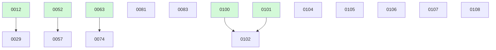

# Backlog

**108 changes** — 🟢 1 in progress · 🔵 1 built · 🟡 6 proposed · ⚪ 3 deferred · ✅ 90 done · 🗑️ 7 killed

## 🟢 In progress (1)

| # | Title | Priority | Type | Spec | Branch | State |
|---|-------|----------|------|------|--------|-------|
| [0081](active/0081-shell-transcript-command-breaks.md) | Echo executed slash commands + rule breaks between transcript blocks | `medium` | `feat` | [spec](../) | `feat/shell-transcript-command-breaks` | building |

## 🔵 Built (1)

| # | Title | Priority | Type | PR | State |
|---|-------|----------|------|----|-------|
| [0102](active/0102-loop-scoped-secret-values-on-startloop-host-bound-and-never.md) | Loop-scoped secret values on StartLoop, host-bound and never recorded | `high` | `feat` | [#125](https://github.com/ethanhinson/fuse/pull/125) | awaiting merge |

## 🟡 Proposed (6)

| # | Title | Priority | Type | Readiness |
|---|-------|----------|------|-----------|
| [0108](active/0108-send-surfaces-a-resume-refusal-instead-of-loop-finished.md) | Send surfaces a resume refusal instead of loop finished | `medium` | `fix` | needs-grooming |
| [0107](active/0107-evict-idle-per-tenant-limiter-buckets-and-admission-locks.md) | Evict idle per-tenant limiter buckets and admission locks | `low` | `fix` | needs-grooming |
| [0106](active/0106-loop-registry-live-count-method-for-the-per-tenant-live-loop.md) | Loop registry live-count method for the per-tenant live-loop cap | `medium` | `feat` | needs-grooming |
| [0105](active/0105-pin-spec-mcp-server-dials-to-the-addresses-checked-at-startl.md) | Pin spec MCP server dials to the addresses checked at StartLoop | `medium` | `fix` | needs-grooming |
| [0104](active/0104-server-aware-validateharness-on-the-loop-service.md) | Server-aware ValidateHarness on the loop service | `medium` | `feat` | needs-grooming |
| [0083](active/0083-fix-two-race-lane-flakes-in-internal-runtime-turn-span-topol.md) | Fix two race-lane flakes in internal/runtime — turn-span topology and Send-enqueue tests | `medium` | `fix` | needs-grooming |

## ⚪ Deferred (3)

| # | Title | Priority | Type |
|---|-------|----------|------|
| [0074](active/0074-sandbox-health-emitter.md) | sandbox health emitter — feed KindSandboxHealth so fuse_sandbox_unhealthy_total stops being defined-but-unfed | `medium` | `feat` |
| [0057](active/0057-egress-identity-builtin-http-tools.md) | Egress identity for built-in HTTP tools — route web_fetch/web_search through the #52 credential seam | `medium` | `feat` |
| [0029](active/0029-read-file-dedup-cache.md) | Read_file content deduplication cache | `medium` | `feat` |

✅🗑️ Archive — done + killed (97)

| # | Title | Closed |
|---|-------|--------|
| [0103](archive/2026-11-01-0103-per-tenant-loop-limits-live-loop-cap-and-start-rate-with-per.md) | Per-tenant loop limits: live-loop cap and start rate with per-tenant overrides | 2026-11-01 |
| [0101](archive/2026-11-01-0101-operator-spec-policy-mcp-host-allowlist-private-network-deny.md) | Operator spec policy: MCP host allowlist, private-network deny, registry-only models | 2026-11-01 |
| [0100](archive/2026-11-01-0100-scoped-principals-rpc-scopes-harness-digest-pin-and-principa.md) | Scoped principals: RPC scopes, harness digest pin and principal record on every loop | 2026-11-01 |
| [0099](archive/2026-11-01-0099-trusted-issuers-verify-jwks-asymmetric-keys-with-kid-selecti.md) | Trusted issuers verify JWKS asymmetric keys with kid selection and tenant prefixes | 2026-11-01 |
| [0098](archive/2026-10-31-0098-permission-deny-reasons-bound-and-redact-the-command-they-ec.md) | Permission deny reasons bound and redact the command they echo | 2026-10-31 |
| [0097](archive/2026-10-31-0097-approve-all-carries-across-the-cli-model-relay-and-policy-de.md) | Approve-all carries across the CLI-model relay, and policy denials say who denied | 2026-10-31 |
| [0096](archive/2026-10-31-0096-unparseable-shell-commands-are-denied-when-no-human-approver.md) | Unparseable shell commands are denied when no human approver is bound | 2026-10-31 |
| [0095](archive/2026-10-31-0095-workers-must-declare-tools-and-worker-requires-an-active-wor.md) | Workers must declare tools, and worker requires an active workflow | 2026-10-31 |
| [0094](archive/2026-10-31-0094-approval-provenance-is-per-gate-not-per-process.md) | Approval provenance is per gate, not per process | 2026-10-31 |
| [0093](archive/2026-10-31-0093-permission-floor-and-wrapper-parity-across-modes-and-binding.md) | Permission floor and wrapper parity across modes and bindings | 2026-10-31 |
| [0092](archive/2026-10-31-0092-smart-mode-honors-always-prompt-with-no-human-approver-bound.md) | Smart mode honors always_prompt with no human approver bound | 2026-10-31 |
| [0091](archive/2026-10-31-0091-workflows-activate-per-spawn-in-every-host-enforcing-pools-a.md) | Workflows activate per spawn in every host, enforcing pools and worker tools | 2026-10-31 |
| [0090](archive/2026-10-31-0090-turn-and-token-budgets-are-enforced-in-hosted-interactive-lo.md) | Turn and token budgets are enforced in hosted interactive loops | 2026-10-31 |
| [0089](archive/2026-10-31-0089-static-credential-mcp-servers-authenticate-and-every-loop-re.md) | Static-credential MCP servers authenticate, and every loop reports its MCP servers | 2026-10-31 |
| [0088](archive/2026-10-31-0088-protective-permission-patterns-match-across-slashes-and-in-e.md) | Protective permission patterns match across slashes and in every mode alike | 2026-10-31 |
| [0087](archive/2026-10-31-0087-explicit-ask-rules-are-honored-prompt-a-human-deny-when-no-h.md) | Explicit ask rules are honored: prompt a human, deny when no human is bound | 2026-10-31 |
| [0025](archive/2026-08-08-0025-agent-to-agent-messaging.md) | Agent-to-agent messaging — note passing for debate/refine patterns | 2026-08-08 |
| [0022](archive/2026-08-08-0022-mcp-websocket-transport.md) | WebSocket transport for MCP | 2026-08-08 |
| [0032](archive/2026-08-05-0032-shell-mode-switcher.md) | Shell permission-mode switcher — cycle smart/auto in the TUI, with a visible mode indicator | 2026-08-05 |
| [0016](archive/2026-08-05-0016-one-shot-cli-approvals.md) | Remove the AlwaysApprove one-shot bypass; surface approvals at the CLI | 2026-08-05 |
| [0011](archive/2026-08-05-0011-deep-research.md) | Deep Research Mode — Web Search + Fan-out Synthesis | 2026-08-05 |
| [0009](archive/2026-08-04-0009-mcp-management-cli.md) | `fuse mcps` MCP Server Management CLI + `/mcps` Shell Built-in | 2026-08-04 |

**Older done (collapsed)**

| Month | Done |
|-------|------|
| [2026-10](archive/) | 3 done |
| [2026-09](archive/) | 7 done |
| [2026-08](archive/) | 65 done |

