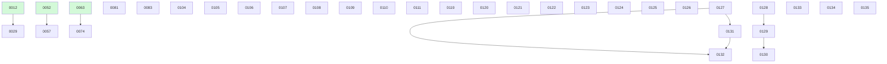

# Backlog

**135 changes** — 🟢 1 in progress · 🟣 6 groomed · 🟡 20 proposed · ⚪ 3 deferred · ✅ 98 done · 🗑️ 7 killed

## 🟢 In progress (1)

| # | Title | Priority | Type | Spec | Branch | State |
|---|-------|----------|------|------|--------|-------|
| [0081](active/0081-shell-transcript-command-breaks.md) | Echo executed slash commands + rule breaks between transcript blocks | `medium` | `feat` | [spec](../) | `feat/shell-transcript-command-breaks` | building |

## 🟣 Groomed (6)

| # | Title | Priority | Type | Spec | Readiness |
|---|-------|----------|------|------|-----------|
| [0135](active/0135-mcp-oauth-tokens-live-in-a-token-store-adapter-and-never-ope.md) | MCP OAuth tokens live in a token store adapter and never open a browser on a server | `high` | `fix` | [spec](../superpowers/specs/2026-11-03-mcp-oauth-tokens-live-in-a-token-store-adapter-and-never-ope-design.md) | build-ready |
| [0134](active/0134-installed-skills-come-from-a-skill-source-adapter-consistent.md) | Installed skills come from a skill source adapter, consistent across replicas | `medium` | `feat` | [spec](../superpowers/specs/2026-11-03-installed-skills-come-from-a-skill-source-adapter-consistent-design.md) | build-ready |
| [0133](active/0133-shared-admission-adapter-for-sandbox-concurrency-and-tenant.md) | Shared admission adapter for sandbox concurrency and tenant start rate | `medium` | `feat` | [spec](../superpowers/specs/2026-11-03-shared-admission-adapter-for-sandbox-concurrency-and-tenant-design.md) | build-ready |
| [0128](active/0128-loop-artifact-store-adapter-for-spilled-tool-output-and-comp.md) | Loop artifact store adapter for spilled tool output and compaction segments | `high` | `feat` | [spec](../superpowers/specs/2026-11-03-loop-artifact-store-adapter-for-spilled-tool-output-and-comp-design.md) | build-ready |
| [0127](active/0127-resume-rebuilds-the-whole-loop-state-from-the-stream.md) | Resume rebuilds the whole loop state from the stream | `high` | `fix` | [spec](../superpowers/specs/2026-11-03-resume-rebuilds-the-whole-loop-state-from-the-stream-design.md) | build-ready |
| [0126](active/0126-fenced-loop-ownership-and-cross-replica-activity-in-the-loop.md) | Fenced loop ownership and cross-replica activity in the loop registry | `high` | `fix` | [spec](../superpowers/specs/2026-11-03-fenced-loop-ownership-and-cross-replica-activity-in-the-loop-design.md) | build-ready |

## 🟡 Proposed (20)

| # | Title | Priority | Type | Readiness |
|---|-------|----------|------|-----------|
| [0132](active/0132-pipeline-runs-are-event-sourced-and-resumable.md) | Pipeline runs are event-sourced and resumable | `medium` | `feat` | ⏳ waiting on #127 — not yet built |
| [0131](active/0131-the-blackboard-is-durable-and-shared-across-replicas.md) | The blackboard is durable and shared across replicas | `high` | `feat` | ⏳ waiting on #127 — not yet built |
| [0130](active/0130-workspaces-follow-a-loop-across-replicas.md) | Workspaces follow a loop across replicas | `high` | `feat` | ⏳ waiting on #129 — not yet built |
| [0129](active/0129-per-loop-workspace-adapter-and-confined-file-tools.md) | Per-loop workspace adapter and confined file tools | `high` | `feat` | ⏳ waiting on #128 — not yet built |
| [0125](active/0125-stop-the-current-turn-of-an-interactive-loop-without-ending.md) | Stop the current turn of an interactive loop without ending it | `low` | `feat` | needs-grooming |
| [0124](active/0124-the-expects-hint-composes-with-role-and-tool-less-prompts.md) | The expects hint composes with role and tool-less prompts | `medium` | `fix` | needs-grooming |
| [0123](active/0123-observe-marks-where-replay-ends-and-live-events-begin.md) | Observe marks where replay ends and live events begin | `low` | `feat` | needs-grooming |
| [0122](active/0122-spawn-start-names-the-worker-a-child-was-bound-to.md) | spawn.start names the worker a child was bound to | `low` | `feat` | needs-grooming |
| [0121](active/0121-go-sdk-cancel-a-loop.md) | Go SDK: cancel a loop | `low` | `feat` | needs-grooming |
| [0120](active/0120-at-most-one-loop-cancelled-per-loop-under-replica-races.md) | At most one loop.cancelled per loop under replica races | `low` | `fix` | needs-grooming |
| [0119](active/0119-send-to-a-loop-cancelled-on-another-replica-says-loop-cancel.md) | Send to a loop cancelled on another replica says loop cancelled | `low` | `fix` | needs-grooming |
| [0111](active/0111-one-shared-redirect-policy-for-every-client-that-carries-cre.md) | One shared redirect policy for every client that carries credentials | `medium` | `fix` | needs-grooming |
| [0110](active/0110-mark-loopsecret-value-debug-redact-once-protobuf-go-honours.md) | Mark LoopSecret.value debug_redact once protobuf-go honours it | `low` | `feat` | needs-grooming |
| [0109](active/0109-type-based-guard-that-no-wire-request-carrying-secrets-is-ev.md) | Type-based guard that no wire request carrying secrets is ever formatted | `low` | `feat` | needs-grooming |
| [0108](active/0108-send-surfaces-a-resume-refusal-instead-of-loop-finished.md) | Send surfaces a resume refusal instead of loop finished | `medium` | `fix` | needs-grooming |
| [0107](active/0107-evict-idle-per-tenant-limiter-buckets-and-admission-locks.md) | Evict idle per-tenant limiter buckets and admission locks | `low` | `fix` | needs-grooming |
| [0106](active/0106-loop-registry-live-count-method-for-the-per-tenant-live-loop.md) | Loop registry live-count method for the per-tenant live-loop cap | `medium` | `feat` | needs-grooming |
| [0105](active/0105-pin-spec-mcp-server-dials-to-the-addresses-checked-at-startl.md) | Pin spec MCP server dials to the addresses checked at StartLoop | `medium` | `fix` | needs-grooming |
| [0104](active/0104-server-aware-validateharness-on-the-loop-service.md) | Server-aware ValidateHarness on the loop service | `medium` | `feat` | needs-grooming |
| [0083](active/0083-fix-two-race-lane-flakes-in-internal-runtime-turn-span-topol.md) | Fix two race-lane flakes in internal/runtime — turn-span topology and Send-enqueue tests | `medium` | `fix` | needs-grooming |

## ⚪ Deferred (3)

| # | Title | Priority | Type |
|---|-------|----------|------|
| [0074](active/0074-sandbox-health-emitter.md) | sandbox health emitter — feed KindSandboxHealth so fuse_sandbox_unhealthy_total stops being defined-but-unfed | `medium` | `feat` |
| [0057](active/0057-egress-identity-builtin-http-tools.md) | Egress identity for built-in HTTP tools — route web_fetch/web_search through the #52 credential seam | `medium` | `feat` |
| [0029](active/0029-read-file-dedup-cache.md) | Read_file content deduplication cache | `medium` | `feat` |

✅🗑️ Archive — done + killed (105)

| # | Title | Closed |
|---|-------|--------|
| [0118](archive/2026-11-03-0118-carried-skills-a-harness-spec-may-define-a-skill-inline.md) | Carried skills: a harness spec may define a skill inline | 2026-11-03 |
| [0117](archive/2026-11-03-0117-cancel-rpc-on-the-networked-loop-server.md) | Cancel RPC on the networked loop server | 2026-11-03 |
| [0116](archive/2026-11-03-0116-roles-and-workers-can-be-tool-less.md) | Tool-less loops, roles and workers | 2026-11-03 |
| [0115](archive/2026-11-02-0115-pipeline-steps-name-a-role-roles-in-the-synthesis-palette.md) | Pipeline steps name a role; roles in the synthesis palette | 2026-11-02 |
| [0114](archive/2026-11-02-0114-spawn-agent-picks-a-role-role-enum-with-descriptions-role-br.md) | spawn_agent picks a role: role enum with descriptions, role brief composed into the child prompt | 2026-11-02 |
| [0113](archive/2026-11-02-0113-roles-named-helper-definitions-in-the-harness-spec.md) | Roles: named helper definitions in the harness spec | 2026-11-02 |
| [0112](archive/2026-11-01-0112-harness-instructions-a-free-text-task-brief-composed-into-th.md) | Harness instructions: a free-text task brief composed into the system prompt | 2026-11-01 |
| [0103](archive/2026-11-01-0103-per-tenant-loop-limits-live-loop-cap-and-start-rate-with-per.md) | Per-tenant loop limits: live-loop cap and start rate with per-tenant overrides | 2026-11-01 |
| [0102](archive/2026-11-01-0102-loop-scoped-secret-values-on-startloop-host-bound-and-never.md) | Loop-scoped secret values on StartLoop, host-bound and never recorded | 2026-11-01 |
| [0101](archive/2026-11-01-0101-operator-spec-policy-mcp-host-allowlist-private-network-deny.md) | Operator spec policy: MCP host allowlist, private-network deny, registry-only models | 2026-11-01 |
| [0100](archive/2026-11-01-0100-scoped-principals-rpc-scopes-harness-digest-pin-and-principa.md) | Scoped principals: RPC scopes, harness digest pin and principal record on every loop | 2026-11-01 |
| [0099](archive/2026-11-01-0099-trusted-issuers-verify-jwks-asymmetric-keys-with-kid-selecti.md) | Trusted issuers verify JWKS asymmetric keys with kid selection and tenant prefixes | 2026-11-01 |
| [0098](archive/2026-10-31-0098-permission-deny-reasons-bound-and-redact-the-command-they-ec.md) | Permission deny reasons bound and redact the command they echo | 2026-10-31 |
| [0097](archive/2026-10-31-0097-approve-all-carries-across-the-cli-model-relay-and-policy-de.md) | Approve-all carries across the CLI-model relay, and policy denials say who denied | 2026-10-31 |
| [0096](archive/2026-10-31-0096-unparseable-shell-commands-are-denied-when-no-human-approver.md) | Unparseable shell commands are denied when no human approver is bound | 2026-10-31 |
| [0095](archive/2026-10-31-0095-workers-must-declare-tools-and-worker-requires-an-active-wor.md) | Workers must declare tools, and worker requires an active workflow | 2026-10-31 |
| [0025](archive/2026-08-08-0025-agent-to-agent-messaging.md) | Agent-to-agent messaging — note passing for debate/refine patterns | 2026-08-08 |
| [0022](archive/2026-08-08-0022-mcp-websocket-transport.md) | WebSocket transport for MCP | 2026-08-08 |
| [0032](archive/2026-08-05-0032-shell-mode-switcher.md) | Shell permission-mode switcher — cycle smart/auto in the TUI, with a visible mode indicator | 2026-08-05 |
| [0016](archive/2026-08-05-0016-one-shot-cli-approvals.md) | Remove the AlwaysApprove one-shot bypass; surface approvals at the CLI | 2026-08-05 |
| [0011](archive/2026-08-05-0011-deep-research.md) | Deep Research Mode — Web Search + Fan-out Synthesis | 2026-08-05 |
| [0009](archive/2026-08-04-0009-mcp-management-cli.md) | `fuse mcps` MCP Server Management CLI + `/mcps` Shell Built-in | 2026-08-04 |

**Older done (collapsed)**

| Month | Done |
|-------|------|
| [2026-10](archive/) | 11 done |
| [2026-09](archive/) | 7 done |
| [2026-08](archive/) | 65 done |

