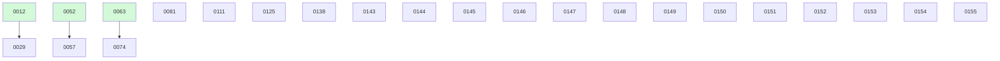

# Backlog

**155 changes** — 🟢 1 in progress · 🔵 1 built · 🟣 1 groomed · 🟡 14 proposed · ⚪ 3 deferred · ✅ 103 done · 🗑️ 32 killed

## 🟢 In progress (1)

| # | Title | Priority | Type | Spec | Branch | State |
|---|-------|----------|------|------|--------|-------|
| [0081](active/0081-shell-transcript-command-breaks.md) | Echo executed slash commands + rule breaks between transcript blocks | `medium` | `feat` | [spec](../) | `feat/shell-transcript-command-breaks` | building |

## 🔵 Built (1)

| # | Title | Priority | Type | PR | State |
|---|-------|----------|------|----|-------|
| [0155](active/0155-no-limit-applies-unless-someone-sets-one-unlimited-headless.md) | No limit applies unless someone sets one: unlimited headless turns and no assumed context window | `high` | `fix` | [#175](https://github.com/ethanhinson/fuse/pull/175) | awaiting merge |

## 🟣 Groomed (1)

| # | Title | Priority | Type | Spec | Readiness |
|---|-------|----------|------|------|-----------|
| [0143](active/0143-headless-runs-finish-through-a-structured-report-and-a-plain.md) | Headless runs finish through a structured report, and a plain stop is never success | `high` | `feat` | [spec](../superpowers/specs/2026-11-07-headless-runs-finish-through-a-structured-report-and-a-plain-design.md) | build-ready |

## 🟡 Proposed (14)

| # | Title | Priority | Type | Readiness |
|---|-------|----------|------|-----------|
| [0154](active/0154-remove-code-left-inert-by-the-server-removal.md) | Remove code left inert by the server removal | `low` | `chore` | needs-grooming |
| [0153](active/0153-user-hooks-around-tool-calls.md) | User hooks around tool calls | `low` | `feat` | needs-grooming |
| [0152](active/0152-os-sandbox-for-local-bash.md) | OS sandbox for local bash | `low` | `feat` | needs-grooming |
| [0151](active/0151-task-container-image-and-entrypoint.md) | Task container image and entrypoint | `medium` | `feat` | needs-grooming |
| [0150](active/0150-per-model-profiles-for-prompt-edit-tool-and-effort.md) | Per-model profiles for prompt, edit tool and effort | `medium` | `feat` | needs-grooming |
| [0149](active/0149-resume-a-previous-shell-session.md) | Resume a previous shell session | `medium` | `feat` | needs-grooming |
| [0148](active/0148-show-edit-diffs-in-the-shell.md) | Show edit diffs in the shell | `medium` | `feat` | needs-grooming |
| [0147](active/0147-hard-limits-and-clean-shutdown-for-headless-runs.md) | Hard limits and clean shutdown for headless runs | `high` | `feat` | needs-grooming |
| [0146](active/0146-one-shot-runs-write-an-event-log.md) | One-shot runs write an event log | `high` | `feat` | needs-grooming |
| [0145](active/0145-load-agents-md-into-the-root-agent-s-system-prompt.md) | Load AGENTS.md into the root agent's system prompt | `high` | `feat` | needs-grooming |
| [0144](active/0144-write-file-refuses-to-overwrite-a-file-the-agent-has-not-rea.md) | write_file refuses to overwrite a file the agent has not read | `high` | `feat` | needs-grooming |
| [0138](active/0138-artifact-retention-spilled-output-and-segments-expire.md) | Artifact retention: spilled output and segments expire | `medium` | `feat` | needs-grooming |
| [0125](active/0125-stop-the-current-turn-of-an-interactive-loop-without-ending.md) | Stop the current turn in the shell without ending the session | `low` | `feat` | needs-grooming |
| [0111](active/0111-one-shared-redirect-policy-for-every-client-that-carries-cre.md) | One shared redirect policy for every client that carries credentials | `medium` | `fix` | needs-grooming |

## ⚪ Deferred (3)

| # | Title | Priority | Type |
|---|-------|----------|------|
| [0074](active/0074-sandbox-health-emitter.md) | sandbox health emitter — feed KindSandboxHealth so fuse_sandbox_unhealthy_total stops being defined-but-unfed | `medium` | `feat` |
| [0057](active/0057-egress-identity-builtin-http-tools.md) | Egress identity for built-in HTTP tools — route web_fetch/web_search through the #52 credential seam | `medium` | `feat` |
| [0029](active/0029-read-file-dedup-cache.md) | Read_file content deduplication cache | `medium` | `feat` |

✅🗑️ Archive — done + killed (135)

| # | Title | Closed |
|---|-------|--------|
| [0140](archive/2026-11-07-0140-object-storage-backend-for-the-artifact-store.md) | Object-storage backend for the artifact store | 2026-11-07 |
| [0139](archive/2026-11-07-0139-segment-index-is-safe-with-concurrent-writers.md) | Segment index is safe with concurrent writers | 2026-11-07 |
| [0137](archive/2026-11-07-0137-tool-execution-seam-with-in-process-and-remote-worker-execut.md) | Tool execution seam with in-process and remote-worker executors | 2026-11-07 |
| [0136](archive/2026-11-07-0136-loop-scoped-secrets-can-survive-a-move-through-an-opt-in-sec.md) | Loop-scoped secrets can survive a move through an opt-in secret store adapter | 2026-11-07 |
| [0135](archive/2026-11-07-0135-mcp-oauth-tokens-live-in-a-token-store-adapter-and-never-ope.md) | MCP OAuth tokens live in a token store adapter and never open a browser on a server | 2026-11-07 |
| [0134](archive/2026-11-07-0134-installed-skills-come-from-a-skill-source-adapter-consistent.md) | Installed skills come from a skill source adapter, consistent across replicas | 2026-11-07 |
| [0133](archive/2026-11-07-0133-shared-admission-adapter-for-sandbox-concurrency-and-tenant.md) | Shared admission adapter for sandbox concurrency and tenant start rate | 2026-11-07 |
| [0132](archive/2026-11-07-0132-pipeline-runs-are-event-sourced-and-resumable.md) | Pipeline runs are event-sourced and resumable | 2026-11-07 |
| [0131](archive/2026-11-07-0131-the-blackboard-is-durable-and-shared-across-replicas.md) | The blackboard is durable and shared across replicas | 2026-11-07 |
| [0130](archive/2026-11-07-0130-workspaces-follow-a-loop-across-replicas.md) | Workspaces follow a loop across replicas | 2026-11-07 |
| [0129](archive/2026-11-07-0129-per-loop-workspace-adapter-and-confined-file-tools.md) | Per-loop workspace adapter and confined file tools | 2026-11-07 |
| [0126](archive/2026-11-07-0126-fenced-loop-ownership-and-cross-replica-activity-in-the-loop.md) | Fenced loop ownership and cross-replica activity in the loop registry | 2026-11-07 |
| [0124](archive/2026-11-07-0124-the-expects-hint-composes-with-role-and-tool-less-prompts.md) | The expects hint composes with role and tool-less prompts | 2026-11-07 |
| [0123](archive/2026-11-07-0123-observe-marks-where-replay-ends-and-live-events-begin.md) | Observe marks where replay ends and live events begin | 2026-11-07 |
| [0122](archive/2026-11-07-0122-spawn-start-names-the-worker-a-child-was-bound-to.md) | spawn.start names the worker a child was bound to | 2026-11-07 |
| [0121](archive/2026-11-07-0121-go-sdk-cancel-a-loop.md) | Go SDK: cancel a loop | 2026-11-07 |
| [0120](archive/2026-11-07-0120-at-most-one-loop-cancelled-per-loop-under-replica-races.md) | At most one loop.cancelled per loop under replica races | 2026-11-07 |
| [0119](archive/2026-11-07-0119-send-to-a-loop-cancelled-on-another-replica-says-loop-cancel.md) | Send to a loop cancelled on another replica says loop cancelled | 2026-11-07 |
| [0110](archive/2026-11-07-0110-mark-loopsecret-value-debug-redact-once-protobuf-go-honours.md) | Mark LoopSecret.value debug_redact once protobuf-go honours it | 2026-11-07 |
| [0109](archive/2026-11-07-0109-type-based-guard-that-no-wire-request-carrying-secrets-is-ev.md) | Type-based guard that no wire request carrying secrets is ever formatted | 2026-11-07 |
| [0108](archive/2026-11-07-0108-send-surfaces-a-resume-refusal-instead-of-loop-finished.md) | Send surfaces a resume refusal instead of loop finished | 2026-11-07 |
| [0107](archive/2026-11-07-0107-evict-idle-per-tenant-limiter-buckets-and-admission-locks.md) | Evict idle per-tenant limiter buckets and admission locks | 2026-11-07 |
| [0106](archive/2026-11-07-0106-loop-registry-live-count-method-for-the-per-tenant-live-loop.md) | Loop registry live-count method for the per-tenant live-loop cap | 2026-11-07 |
| [0105](archive/2026-11-07-0105-pin-spec-mcp-server-dials-to-the-addresses-checked-at-startl.md) | Pin spec MCP server dials to the addresses checked at StartLoop | 2026-11-07 |
| [0104](archive/2026-11-07-0104-server-aware-validateharness-on-the-loop-service.md) | Server-aware ValidateHarness on the loop service | 2026-11-07 |
| [0083](archive/2026-11-07-0083-fix-two-race-lane-flakes-in-internal-runtime-turn-span-topol.md) | Fix two race-lane flakes in internal/runtime — turn-span topology and Send-enqueue tests | 2026-11-07 |
| [0142](archive/2026-11-06-0142-compound-shell-commands-reach-the-auto-mode-classifier-with.md) | Compound shell commands: parse-layer decomposition with per-part deterministic evaluation | 2026-11-06 |
| [0127](archive/2026-11-05-0127-resume-rebuilds-the-whole-loop-state-from-the-stream.md) | Resume rebuilds the whole loop state from the stream | 2026-11-05 |
| [0141](archive/2026-11-04-0141-add-a-clear-command-to-reset-the-conversation-between-tasks.md) | Add a /clear command to reset the conversation between tasks | 2026-11-04 |
| [0128](archive/2026-11-04-0128-loop-artifact-store-adapter-for-spilled-tool-output-and-comp.md) | Loop artifact store adapter for spilled tool output and compaction segments | 2026-11-04 |
| [0118](archive/2026-11-03-0118-carried-skills-a-harness-spec-may-define-a-skill-inline.md) | Carried skills: a harness spec may define a skill inline | 2026-11-03 |
| [0117](archive/2026-11-03-0117-cancel-rpc-on-the-networked-loop-server.md) | Cancel RPC on the networked loop server | 2026-11-03 |
| [0116](archive/2026-11-03-0116-roles-and-workers-can-be-tool-less.md) | Tool-less loops, roles and workers | 2026-11-03 |
| [0115](archive/2026-11-02-0115-pipeline-steps-name-a-role-roles-in-the-synthesis-palette.md) | Pipeline steps name a role; roles in the synthesis palette | 2026-11-02 |
| [0114](archive/2026-11-02-0114-spawn-agent-picks-a-role-role-enum-with-descriptions-role-br.md) | spawn_agent picks a role: role enum with descriptions, role brief composed into the child prompt | 2026-11-02 |
| [0113](archive/2026-11-02-0113-roles-named-helper-definitions-in-the-harness-spec.md) | Roles: named helper definitions in the harness spec | 2026-11-02 |
| [0112](archive/2026-11-01-0112-harness-instructions-a-free-text-task-brief-composed-into-th.md) | Harness instructions: a free-text task brief composed into the system prompt | 2026-11-01 |
| [0103](archive/2026-11-01-0103-per-tenant-loop-limits-live-loop-cap-and-start-rate-with-per.md) | Per-tenant loop limits: live-loop cap and start rate with per-tenant overrides | 2026-11-01 |
| [0102](archive/2026-11-01-0102-loop-scoped-secret-values-on-startloop-host-bound-and-never.md) | Loop-scoped secret values on StartLoop, host-bound and never recorded | 2026-11-01 |
| [0101](archive/2026-11-01-0101-operator-spec-policy-mcp-host-allowlist-private-network-deny.md) | Operator spec policy: MCP host allowlist, private-network deny, registry-only models | 2026-11-01 |
| [0097](archive/2026-10-31-0097-approve-all-carries-across-the-cli-model-relay-and-policy-de.md) | Approve-all carries across the CLI-model relay, and policy denials say who denied | 2026-10-31 |
| [0025](archive/2026-08-08-0025-agent-to-agent-messaging.md) | Agent-to-agent messaging — note passing for debate/refine patterns | 2026-08-08 |
| [0022](archive/2026-08-08-0022-mcp-websocket-transport.md) | WebSocket transport for MCP | 2026-08-08 |
| [0032](archive/2026-08-05-0032-shell-mode-switcher.md) | Shell permission-mode switcher — cycle smart/auto in the TUI, with a visible mode indicator | 2026-08-05 |
| [0016](archive/2026-08-05-0016-one-shot-cli-approvals.md) | Remove the AlwaysApprove one-shot bypass; surface approvals at the CLI | 2026-08-05 |
| [0011](archive/2026-08-05-0011-deep-research.md) | Deep Research Mode — Web Search + Fan-out Synthesis | 2026-08-05 |
| [0009](archive/2026-08-04-0009-mcp-management-cli.md) | `fuse mcps` MCP Server Management CLI + `/mcps` Shell Built-in | 2026-08-04 |

**Older done (collapsed)**

| Month | Done |
|-------|------|
| [2026-11](archive/) | 2 done |
| [2026-10](archive/) | 14 done |
| [2026-09](archive/) | 7 done |
| [2026-08](archive/) | 65 done |

