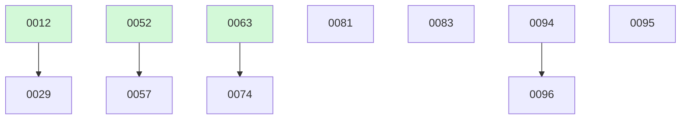

# Backlog

**96 changes** — 🟢 1 in progress · 🔵 2 built · 🟡 2 proposed · ⚪ 3 deferred · ✅ 82 done · 🗑️ 6 killed

## 🟢 In progress (1)

| # | Title | Priority | Type | Spec | Branch | State |
|---|-------|----------|------|------|--------|-------|
| [0081](active/0081-shell-transcript-command-breaks.md) | Echo executed slash commands + rule breaks between transcript blocks | `medium` | `feat` | [spec](../) | `feat/shell-transcript-command-breaks` | building |

## 🔵 Built (2)

| # | Title | Priority | Type | PR | State |
|---|-------|----------|------|----|-------|
| [0095](active/0095-workers-must-declare-tools-and-worker-requires-an-active-wor.md) | Workers must declare tools, and worker requires an active workflow | `medium` | `fix` | [#117](https://github.com/ethanhinson/fuse/pull/117) | awaiting merge |
| [0094](active/0094-approval-provenance-is-per-gate-not-per-process.md) | Approval provenance is per gate, not per process | `medium` | `fix` | [#118](https://github.com/ethanhinson/fuse/pull/118) | awaiting merge |

## 🟡 Proposed (2)

| # | Title | Priority | Type | Readiness |
|---|-------|----------|------|-----------|
| [0096](active/0096-unparseable-shell-commands-are-denied-when-no-human-approver.md) | Unparseable shell commands are denied when no human approver is bound | `high` | `fix` | ⏳ waiting on #94 — needs your merge |
| [0083](active/0083-fix-two-race-lane-flakes-in-internal-runtime-turn-span-topol.md) | Fix two race-lane flakes in internal/runtime — turn-span topology and Send-enqueue tests | `medium` | `fix` | needs-grooming |

## ⚪ Deferred (3)

| # | Title | Priority | Type |
|---|-------|----------|------|
| [0074](active/0074-sandbox-health-emitter.md) | sandbox health emitter — feed KindSandboxHealth so fuse_sandbox_unhealthy_total stops being defined-but-unfed | `medium` | `feat` |
| [0057](active/0057-egress-identity-builtin-http-tools.md) | Egress identity for built-in HTTP tools — route web_fetch/web_search through the #52 credential seam | `medium` | `feat` |
| [0029](active/0029-read-file-dedup-cache.md) | Read_file content deduplication cache | `medium` | `feat` |

✅🗑️ Archive — done + killed (88)

| # | Title | Closed |
|---|-------|--------|
| [0093](archive/2026-10-31-0093-permission-floor-and-wrapper-parity-across-modes-and-binding.md) | Permission floor and wrapper parity across modes and bindings | 2026-10-31 |
| [0092](archive/2026-10-31-0092-smart-mode-honors-always-prompt-with-no-human-approver-bound.md) | Smart mode honors always_prompt with no human approver bound | 2026-10-31 |
| [0091](archive/2026-10-31-0091-workflows-activate-per-spawn-in-every-host-enforcing-pools-a.md) | Workflows activate per spawn in every host, enforcing pools and worker tools | 2026-10-31 |
| [0090](archive/2026-10-31-0090-turn-and-token-budgets-are-enforced-in-hosted-interactive-lo.md) | Turn and token budgets are enforced in hosted interactive loops | 2026-10-31 |
| [0089](archive/2026-10-31-0089-static-credential-mcp-servers-authenticate-and-every-loop-re.md) | Static-credential MCP servers authenticate, and every loop reports its MCP servers | 2026-10-31 |
| [0088](archive/2026-10-31-0088-protective-permission-patterns-match-across-slashes-and-in-e.md) | Protective permission patterns match across slashes and in every mode alike | 2026-10-31 |
| [0087](archive/2026-10-31-0087-explicit-ask-rules-are-honored-prompt-a-human-deny-when-no-h.md) | Explicit ask rules are honored: prompt a human, deny when no human is bound | 2026-10-31 |
| [0086](archive/2026-10-31-0086-loop-server-advertises-its-capabilities-models-skills-ceilin.md) | Loop server advertises its capabilities - models, skills, ceilings | 2026-10-31 |
| [0085](archive/2026-10-31-0085-start-a-loop-from-a-harnessspec.md) | Start a loop from a HarnessSpec | 2026-10-31 |
| [0084](archive/2026-10-30-0084-harnessspec-proto-and-public-validator.md) | HarnessSpec proto and public validator | 2026-10-30 |
| [0076](archive/2026-09-17-0076-fuse-server-helm-chart-compose-stack.md) | fuse server deployment — a docker-compose stack and a Helm chart over the released image (not an operator) | 2026-09-17 |
| [0075](archive/2026-09-17-0075-paas-remote-sandbox-substrate-adr.md) | PaaS/remote sandbox substrate — the provision/attach/teardown seam ADR, with a Kubernetes warm-Pod handler as first implementation | 2026-09-17 |
| [0082](archive/2026-09-13-0082-build-release-pipeline.md) | build/release pipeline — tag-driven GoReleaser releases (multi-platform archives + GHCR image + curl installer) so users adopt fuse without a Go toolchain | 2026-09-13 |
| [0065](archive/2026-09-05-0065-bash-per-tenant-filesystem-isolation.md) | bash per-tenant filesystem isolation — a Principal.Tenant-scoped bind-mount the working_dir cannot escape | 2026-09-05 |
| [0080](archive/2026-09-02-0080-tui-table-tabbed-ui.md) | Shared TUI table component + tabbed /config UI — line up the menus like Claude | 2026-09-02 |
| [0025](archive/2026-08-08-0025-agent-to-agent-messaging.md) | Agent-to-agent messaging — note passing for debate/refine patterns | 2026-08-08 |
| [0022](archive/2026-08-08-0022-mcp-websocket-transport.md) | WebSocket transport for MCP | 2026-08-08 |
| [0032](archive/2026-08-05-0032-shell-mode-switcher.md) | Shell permission-mode switcher — cycle smart/auto in the TUI, with a visible mode indicator | 2026-08-05 |
| [0016](archive/2026-08-05-0016-one-shot-cli-approvals.md) | Remove the AlwaysApprove one-shot bypass; surface approvals at the CLI | 2026-08-05 |
| [0011](archive/2026-08-05-0011-deep-research.md) | Deep Research Mode — Web Search + Fan-out Synthesis | 2026-08-05 |
| [0009](archive/2026-08-04-0009-mcp-management-cli.md) | `fuse mcps` MCP Server Management CLI + `/mcps` Shell Built-in | 2026-08-04 |

**Older done (collapsed)**

| Month | Done |
|-------|------|
| [2026-09](archive/) | 2 done |
| [2026-08](archive/) | 65 done |

